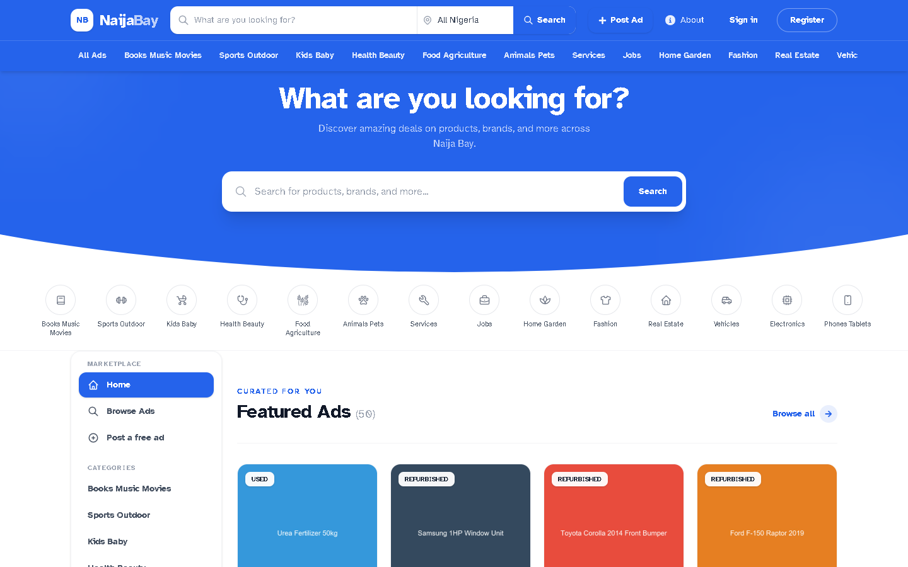
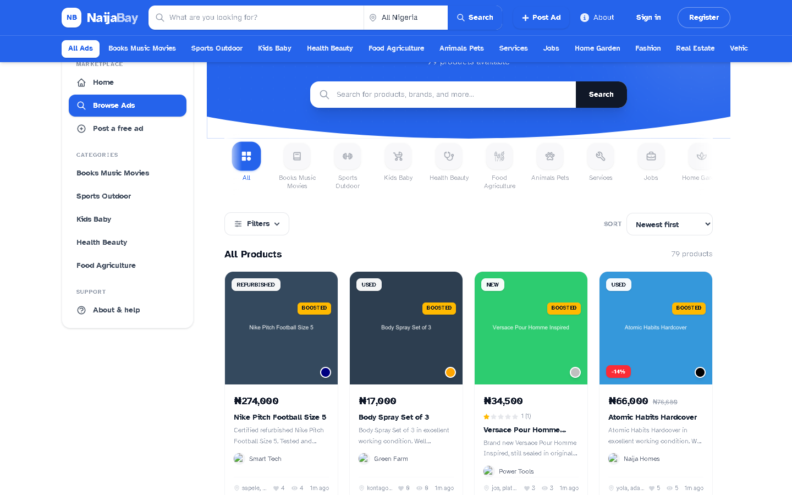
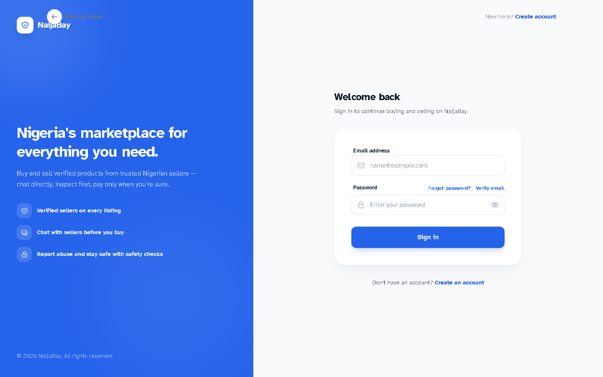
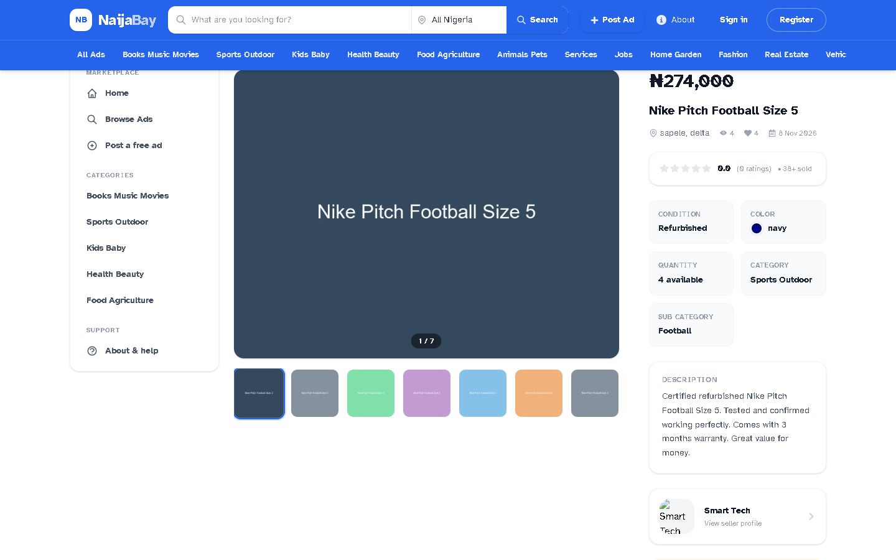
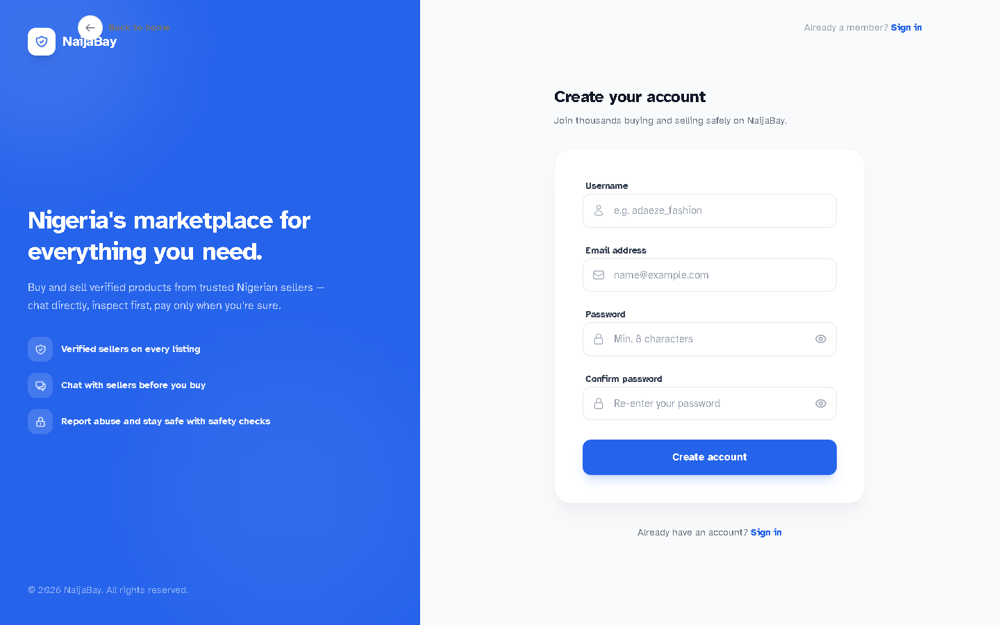
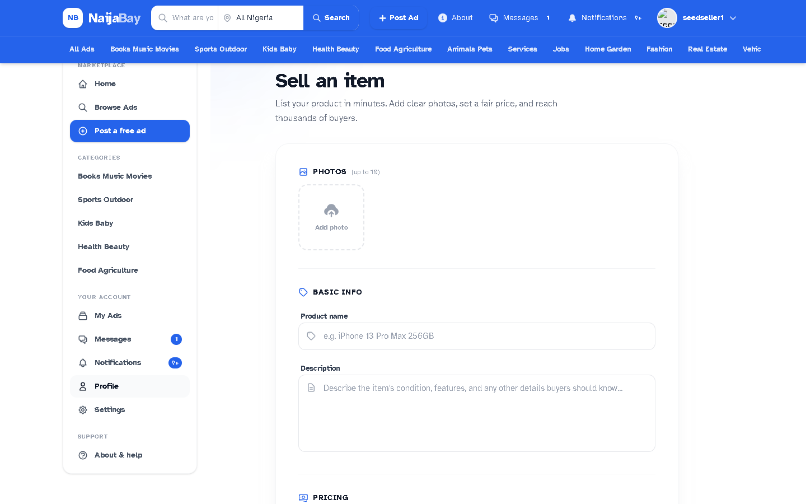
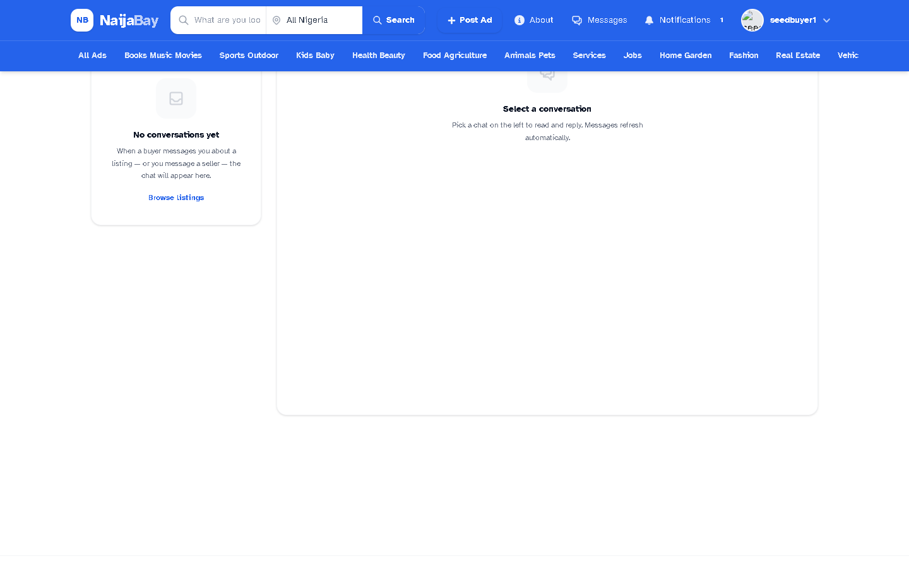
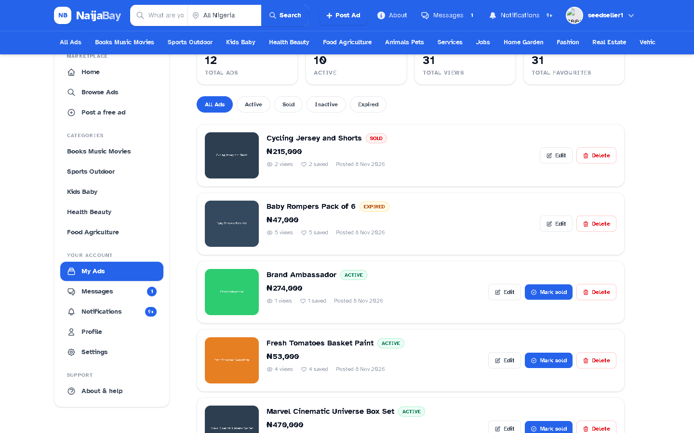

# Naija-Bay

A Nigerian online marketplace in the style of Jiji.ng (classifieds) and Temu (deals, discounts, ratings). Sellers list products, buyers browse, favorite, rate and chat with sellers.

| Part | Folder | Stack |
|---|---|---|
| API | `Backend/` | Django 6, Django REST Framework, auth_kit (cookie JWT), allauth, drf-spectacular |
| Web app | `Frontend/Web/` | React 19, Vite 8, Tailwind 4, Redux Toolkit, TanStack Query, Axios |
| Mobile app | `Frontend/Mobile/` | Not started (empty folder) |

```text
Naija-Bay/
├── UNDERSTAND.md           product, architecture, and handover explainer
├── SCALLING.md             production runbook
├── Backend/
│   ├── NaijaBay/         # settings, urls, ASGI, shared helpers, management/commands (seed commands)
│   ├── accounts/         # users, stores, follows, notifications
│   ├── products/         # products, images, ratings, reports, attribute filters
│   ├── messaging/        # buyer/seller conversations, messages, WebSocket chat
│   ├── orders/           # cart, orders, checkout
│   ├── payments/         # Paystack initialize/verify/webhook, boost plans
│   ├── core/             # states, cities, categories, attribute definitions
│   ├── images/           # screenshots of the web app (REA captures)
│   ├── run_server.py     # migrate + seed everything + start the server
│   ├── manage.py
│   └── requirements.txt
└── Frontend/
    └── Web/
```

## Screenshots

Captured with REA from the live app (see [UNDERSTAND.md](UNDERSTAND.md#15-screenshots) for the full list):

| Desktop | Mobile |
| --- | --- |
|  |  |
|  |  |
|  |  |
|  |  |
|  | |

**Want the product story, architecture, and handover checklist?**
Read [UNDERSTAND.md](UNDERSTAND.md) first. For production setup see
[SCALLING.md](SCALLING.md), [Backend/ENDPOINTS.md](Backend/ENDPOINTS.md),
and [Backend/PRODUCTION.md](Backend/PRODUCTION.md).

## Setup & Environment Guide

### Prerequisites
Windows or WSL/Linux with **Python 3.14**, **Node.js 20+**, and Git. Redis
is optional in development (the backend uses in-memory fallbacks).

### Backend installation

```powershell
cd Backend
py -m venv venv
.\venv\Scripts\Activate.ps1          # Windows; Linux: source venv/bin/activate
pip install -r requirements.txt
copy .env.example .env                # first time only
```

### Frontend installation

```powershell
cd Frontend\Web
npm install
```

### The six environment files

**Backend** (`Backend/`): `.env` (local dev), `.env.production` (production —
loaded **only** when the OS environment has `ENVIRONMENT=production`),
`.env.example` (template, tracked). Values in any of these files never
override real process environment variables.

**Frontend** (`Frontend/Web/`): `.env` (local dev), `.env.production`
(production build), `.env.example` (tracked). Vite inlines Vite variables **at
build time** — rebuild after changing them. Frontend files contain **public
values only**; never put secrets there. A `.env.local` file is not used.

### Variable inventory

Backend (all read by `NaijaBay/settings.py` via python-decouple):

| Variable | Purpose |
| --- | --- |
| `ENVIRONMENT` | `development` / `production` — drives secure-cookie/HTTPS guard rails |
| `SECRET_KEY` | Signing secret for cookies/tokens. **Never reuse dev values in prod** |
| `DEBUG` | Must be `False` in production (fail-fast guard) |
| `ALLOWED_HOSTS`, `CSRF_TRUSTED_ORIGINS`, `CORS_ALLOWED_ORIGINS` | Frontend/API domains |
| `DATABASE_URL` | PostgreSQL URL (empty = local SQLite) |
| `SITE_ID`, `TIME_ZONE`, `LANGUAGE_CODE` | Site/locale defaults |
| `JWT_ACCESS_TOKEN_LIFETIME` (min), `JWT_REFRESH_TOKEN_LIFETIME` (days) | Cookie session lengths |
| `MEDIA_STORAGE_BACKEND` | `local` (dev) \| `s3` \| `cloudinary` (production only) |
| `CLOUD_NAME`, `CLOUD_API_KEY`, `CLOUD_API_SECRET` | Cloudinary direct uploads |
| `AWS_*` (6 vars) | S3/R2-compatible storage (production only) |
| `EMAIL_*`, `DEFAULT_FROM_EMAIL` | SMTP (production; dev uses the console backend) |
| `PAYSTACK_SECRET_KEY` | Paystack (empty in dev = simulated test checkout) |
| `FRONTEND_URL` | Where Paystack sends buyers back after payment |
| `DELIVERY_FEE` | Flat delivery fee per order, in naira |
| `REDIS_URL` | Cache + Channels layer (empty = in-memory in dev) |

Frontend (public, build-time): `VITE_BASE_URL` (API origin) is the only
supported variable.

### Development vs production
Development: SQLite, `MEDIA_STORAGE_BACKEND=local`, console email, empty
`PAYSTACK_SECRET_KEY` (simulated checkout), `DEBUG=True`. Production:
PostgreSQL (`DATABASE_URL`), Redis, `DEBUG=False`, secure cookies + HTTPS
redirects, `PAYSTACK_SECRET_KEY=sk_live_…`, storage `cloudinary`/`s3`.

### Paystack test mode & local webhooks
Set a `sk_test_…` key in your `.env` to exercise the real checkout. Webhook
callbacks require a reachable HTTPS URL — record them from
`dashboard.paystack.com/#/settings/developers` at
`POST /api/v1/payments/webhook/` (signature verified HMAC-SHA512).

### Storage
`local` = `mediafiles/` on disk. `cloudinary`/`s3` = direct browser→provider
uploads with signed params; the backend stores only the key. Never enable AWS
backends in development.

### Database setup
`python manage.py migrate` — fresh DBs use the single `0001_cutover_baseline`
per app. Seed with `python manage.py seed_all` and
`python manage.py attribute_definitions`.

### Starting servers
Backend: `.\venv\Scripts\python.exe -m daphne -p 8000 NaijaBay.asgi:application`
(HTTP + WebSockets on one server). Frontend: `npm run dev` at
`http://localhost:5173`. Use the **same** hostname (`localhost`) for both —
cookies are scope-bound (see present-day notes on local auth).

### Tests
`python manage.py test payments` (32 tests, ~4 min, Paystack mocked),
`accounts`, `products`, `messaging`, `orders`, plus CSRF/axes suites.
Frontend: `npm run lint`, `npm run build`.

### Security notes
- Never commit `.env` / `.env.production` (root `gitignore` covers them).
- Rotate the dev `SECRET_KEY` if it was ever shared; rotate **all** payment/
  storage secrets on any suspected leak.
- Track the `django-axes` cool-off values in `settings.py`
  (`AXES_FAILURE_LIMIT`, `AXES_COOLOFF_TIME`) — see production guide.

### Production prerequisites
PostgreSQL, Redis, HTTPS (Cloudflare or host TLS), `MEDIA_STORAGE_BACKEND`,
SMTP, `PAYSTACK_SECRET_KEY=sk_live_…`, `ALLOWED_HOSTS`/origins set, backup
tested. Full checklist: [Backend/PRODUCTION.md](Backend/PRODUCTION.md).

### Troubleshooting
- `Not Found: /health` in server logs — harmless health-probe traffic.
- CSRF 403s in dev: open the app via `http://localhost:5173` (not `127.0.0.1`),
  and check `CORS/CSRF` origins match.
- Port already in use: `Get-NetTCPConnection -LocalPort 8000 | Stop-Process`.
- Lost seeded data: `python run_server.py --reset-db` (backs up the old DB).

## Quick start

### 1. Backend (Windows PowerShell)

```powershell
cd Backend
py -m venv venv
.\venv\Scripts\Activate.ps1
pip install -r requirements.txt

copy .env.example .env          # first time only

python run_server.py --reset-db # first time only (see note below)
python run_server.py            # every other time
```

`--reset-db` renames any old `db.sqlite3` to `db.sqlite3.bak-<timestamp>` and starts clean. After the cutover reset every app carries a single `0001_cutover_baseline` migration, so a fresh database always matches the models.

`run_server.py` does everything in one go (all seed commands now live under `NaijaBay/management/commands/`):

1. `migrate`
2. Seeds states and cities (`nigeria_states`)
3. Seeds categories and sub-categories (`categories`)
4. Seeds the admin and regular users with avatars and verified emails (`create_user`)
5. Gives every user a store and at least 3 products (`seed_products`)
6. Seeds sellers, buyers, follows, favorites, views, ratings, chats, reports and notifications (`seed_all`)
7. Seeds the 40 attribute definitions and 133 options (`attribute_definitions`)
8. Starts the Django server at http://127.0.0.1:8000

Every seed step is idempotent, so running it again does not create duplicates.

### 2. Frontend

```powershell
cd Frontend\Web
npm install
npm run dev
```

The frontend reads the API address from `Frontend/Web/.env`:

```env
VITE_BASE_URL=http://localhost:8000
```

Open the app at **http://localhost:5173**. Use `localhost` for both the app and the API (not a mix of `localhost` and `127.0.0.1`), otherwise the browser treats them as different sites and the login cookies are not sent.

## Useful addresses

| What | URL |
|---|---|
| Web app | http://localhost:5173 |
| API root | http://localhost:8000/api/v1/ |
| Swagger docs | http://localhost:8000/api/v1/docs/ |
| ReDoc | http://localhost:8000/api/v1/redoc/ |
| Django admin | http://localhost:8000/admin/ |

## Demo logins

Local development only. Emails are already verified, so you can log in straight away.

| Account | Email | Password |
|---|---|---|
| Admin (superuser) | `admin@gmail.com` | `OnlyGod1@` |
| Sellers | `seedseller1@naijabay.test` ... `seedseller8@naijabay.test` | `TestPass123!` |
| Buyers | `seedbuyer1@naijabay.test` ... `seedbuyer8@naijabay.test` | `TestPass123!` |
| Generated users (about 50 in total) | printed as `first.lastNNN@gmail.com` in the database | `Password123@` |

## `run_server.py` options

Run from the `Backend` folder.

| Option | What it does |
|---|---|
| `--reset-db` | Back up `db.sqlite3` with a timestamp and start from a fresh database |
| `--clear` | Wipe seeded marketplace data (superusers are kept), then reseed |
| `--no-images` | Skip generating product photos (faster, saves disk space) |
| `--skip-seed` | Only run migrations and start the server |
| `--skip-migrate` | Skip `makemigrations` and `migrate` |
| `--host`, `--port` | Change where the server listens (default `127.0.0.1:8000`) |
| `--noreload` | Turn off Django's auto-reloader |

Product photos are generated by default: roughly 6-10 per product, so a first run creates around 2,000 files in `Backend/mediafiles` and takes longer. Use `--no-images` for a quick start.

## Seed commands

All live in `Backend/core/management/commands/` and can also be run alone with `python manage.py <name>`.

| Command | Seeds |
|---|---|
| `nigeria_states` | 36 states plus FCT, and their cities |
| `categories` | Categories and sub-categories |
| `create_user` | Admin and regular users, up to 50 in total (`--count`, `--password`; `--user --email --username --password` for one account) |
| `seed_products` | Products and stores for every user, at least 3 products each (`--username`, `--count`, `--images`, `--no-store`) |
| `seed_all` | Sellers, buyers, stores, follows, products, favorites, views, ratings, conversations, messages, reports and notifications (`--clear`, `--images`, `--users`, `--products-per-user`, `--conversations`, `--password`, `--seed`) |

## Configuration

Backend settings come from `Backend/.env` (copy `Backend/.env.example`). The important ones for local work are:

- `DEBUG=True`: without it, `ALLOWED_HOSTS` stays empty and every request is rejected.
- `ALLOWED_HOSTS`, `CSRF_TRUSTED_ORIGINS`, `CORS_ALLOWED_ORIGINS`: must include the frontend origin (`http://localhost:5173`).
- `DATABASE_URL`: leave empty for SQLite, set a URL for PostgreSQL.

Restart the server after changing `.env`. In development, emails (verification, password reset) are printed in the server console instead of being sent.

## Troubleshooting

- **"Bad Request (400)" on every page:** `Backend/.env` is missing or has `DEBUG=False`. Copy `.env.example` to `.env`.
- **"no such table" or "no such column":** the old `db.sqlite3` does not match the models. Run `python run_server.py --reset-db`.
- **Frontend requests go to port 5173 or fail with CORS errors:** check `Frontend/Web/.env` has `VITE_BASE_URL`, restart `npm run dev`, and make sure both sides use `localhost`.
- **Login works in Swagger but not in the app:** the browser is mixing `localhost` and `127.0.0.1`. Use one of them for both.
- **`pip install` complains about `requirements.txt`:** the file is saved as UTF-16. Re-save it as UTF-8.
- **Seeding is slow:** use `--no-images`.
- **`vite.config.js` proxy target:** it reads `https//localhost:8000` (typo). It is not used while the app talks to the API through `VITE_BASE_URL`, but fix it if you ever rely on the proxy.

## More documentation

- `Backend/README.md`: API routes, throttling and environment details
- `Backend/QUICKSTART.md` and `Backend/DEVELOPMENT.md`: backend setup notes
- `Frontend/Web/README.md`: frontend structure and how to add an endpoint
